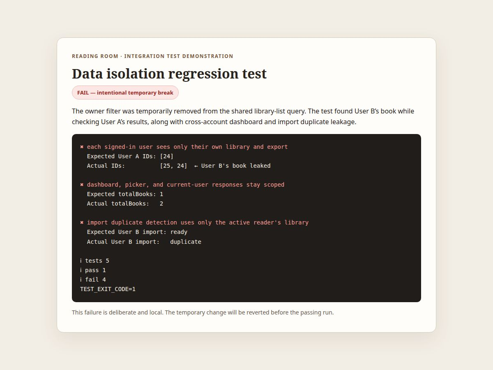
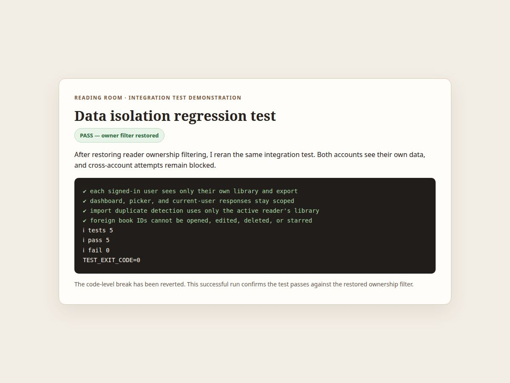

# Data isolation test evidence

These screenshots show the same integration test before and after restoring the reader ownership filter. The temporary code change was reverted and is not included in this branch.

## Controlled failure

The test caught cross-user library data leaking into list, dashboard, and import-preview results.



## Passing after restore

After restoring the per-user ownership filter, all 5 checks passed.



Run the test with:

```sh
pnpm --filter @workspace/api-server run test:data-isolation
```
