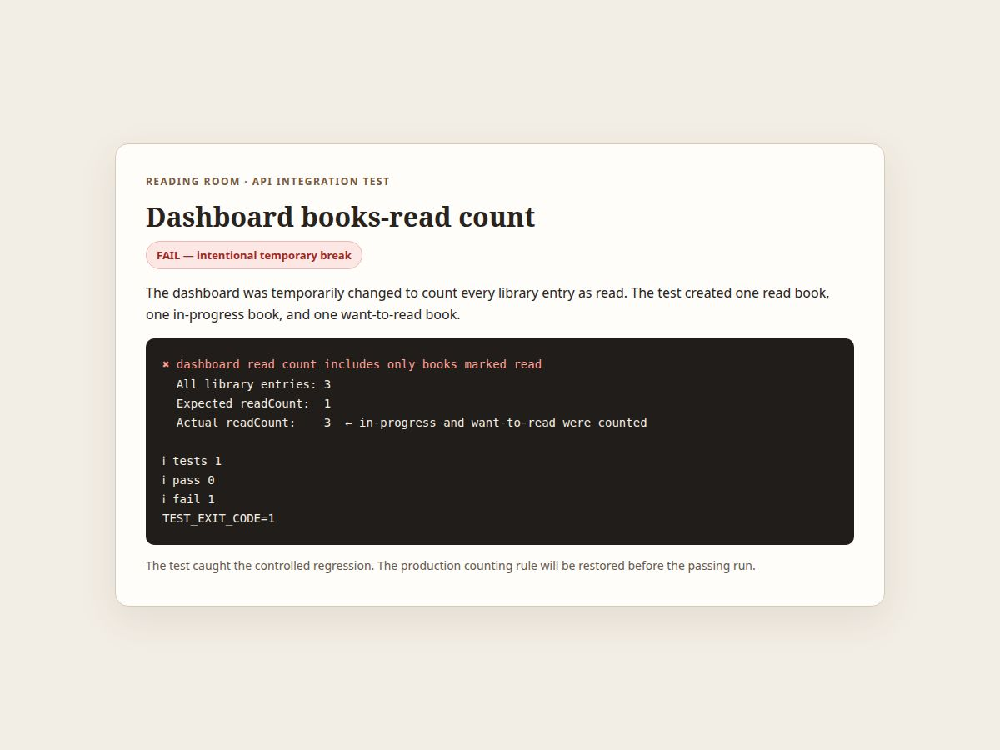
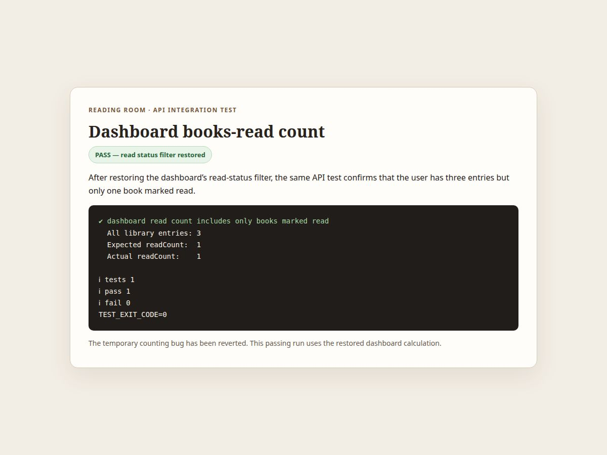

# Dashboard read-count test evidence

The integration test creates one authenticated reader with three book entries: one marked read, one in progress, and one on the want-to-read shelf. The dashboard should report 3 total books and 1 book read.

Run it with:

```sh
pnpm --filter @workspace/api-server run test:dashboard-read-count
```

## Deliberately failing run

The test failed when the dashboard calculation was temporarily changed to count every library entry as read: it returned 3 instead of 1. That temporary bug was reverted and is not included in this branch.



## Passing run after restore

After restoring the read-status filter, the same test passed with readCount = 1 and totalBooks = 3.



A real regression that this test catches is removing or changing the status === "read" filter in computeDashboardSummary, or setting the read count to the total number of library entries.
