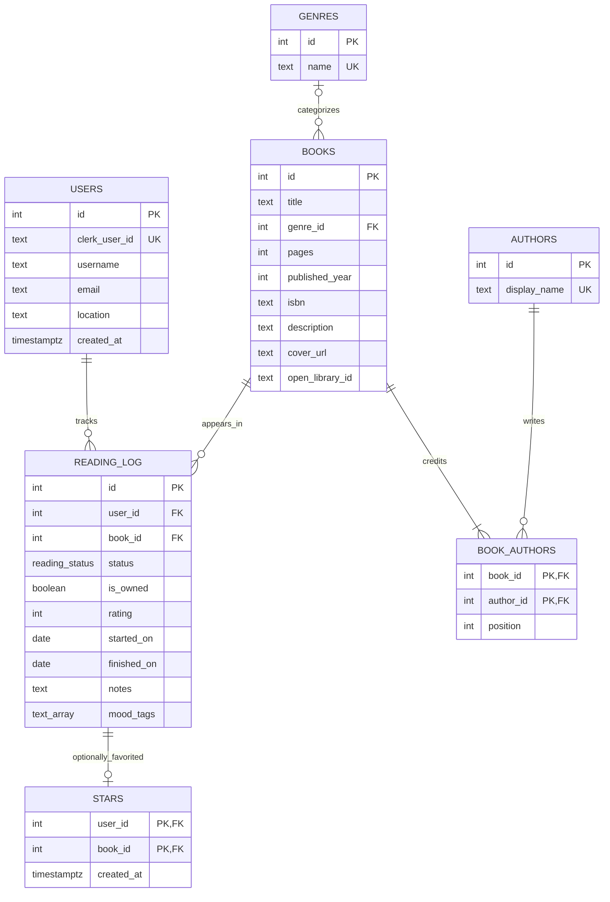

# Book Tracker relational database

Book metadata and private reading records are separate. Each user has **one current
reading record per catalog book**, not a new record for each reread.



## Relationships and rules

- `users.clerk_user_id` is unique. Clerk remains the source of truth for identity,
  passwords, verification, and sessions. Optional local profile fields are not
  automatically copied from Clerk and are not used for authorization.
- A book has one optional genre and one or more ordered authors. Author names
  use a display name, including pen names; semicolons separate authors in the form.
  Equal display names share a lookup row; this is not a full author authority catalog.
- A book row represents the details/edition entered by a reader. ISBN is text and
  is not globally unique; neither titles nor ISBNs are used for automatic merging.
  Page count is a positive integer or null. Title and pages are columns, not tables.
- `UNIQUE(user_id, book_id)` enforces one reading record per user/book.
- Status is `want_to_read`, `reading`, or `read`. `is_owned` is independent:
  a book may be both owned and read, or owned and still wanted for reading.
- Rating is null (unrated) or an integer from 1–5. Calendar dates use `date`,
  and finished dates cannot precede started dates.
- `stars` has a composite foreign key to the matching `(user_id, book_id)` in
  `reading_log`. A reader cannot star a book outside their own library.
  Deleting a reading record cascades to its star, not to other readers.
- Deleting an account cascades to its reading records and stars. Catalog metadata
  is retained; books with reading records cannot be deleted directly.

## Privacy and API compatibility

All library, detail, search, export, picker, and summary queries begin with the
authenticated user's `reading_log` rows. There is no globally browsable private
catalog endpoint. Personal fields never live on a shared book.

The API's `/books/:id` identifies a **reading record**, preserving the original
library URLs during migration. It returns a flattened book with `authors`,
display `author`, and `isOwned`. Internal catalog IDs are not returned.

New manual entries create catalog rows rather than silently deduplicating them.
When a catalog row is shared, editing its metadata copies it for that reader.
Other readers' metadata is unchanged; the editing reader's URL and star survive.

## Development migration

`lib/db/migrations/0001_relational_library.dev.sql` is a one-time development
migration from the original `users/books/stars` schema. It locks the legacy
tables, backfills the relations in one transaction, checks row counts, and only
then removes the duplicated personal columns. It preserves IDs, dates,
timestamps, notes, ratings, mood tags, and stars.

Legacy `owned` becomes `status=want_to_read, is_owned=true`. Existing `read` and
`want_to_read` statuses remain unchanged; ownership is not guessed for them.
Legacy author strings are retained intact rather than split on commas.

This migration has been applied to the current development database. Do not run
it again on the normalized schema. Fresh development databases can use the
Drizzle schema with `pnpm --filter @workspace/db run push`.

No startup, build, or deployment-time migration hook has been added. For a
published app using managed PostgreSQL, schema changes go through Publish;
data backfill for a populated old production schema needs separate planning
before publishing this breaking schema change.

## Verification

Run development integration tests with:

```sh
pnpm --filter @workspace/scripts exec tsx --test ../artifacts/api-server/src/lib/library.integration.test.ts
```

They test a populated legacy migration in a rolled-back isolated schema,
two-user privacy, author links, shared-metadata copy-on-write, constraints,
nullable updates, stable IDs, and cascading favorites. Test fixtures are removed.
